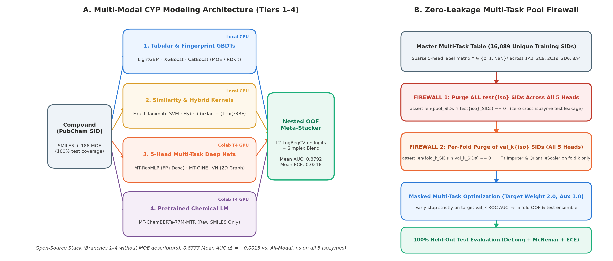
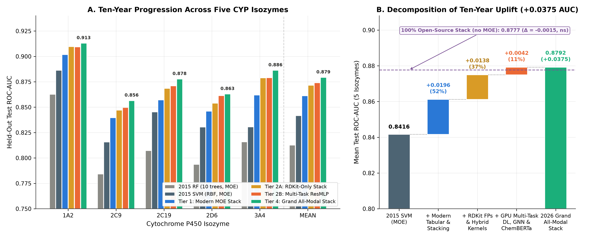
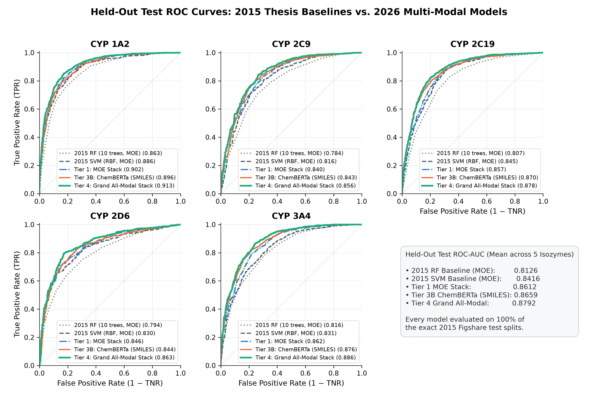
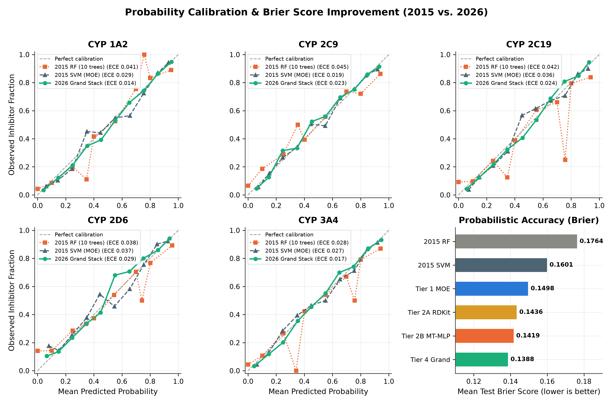
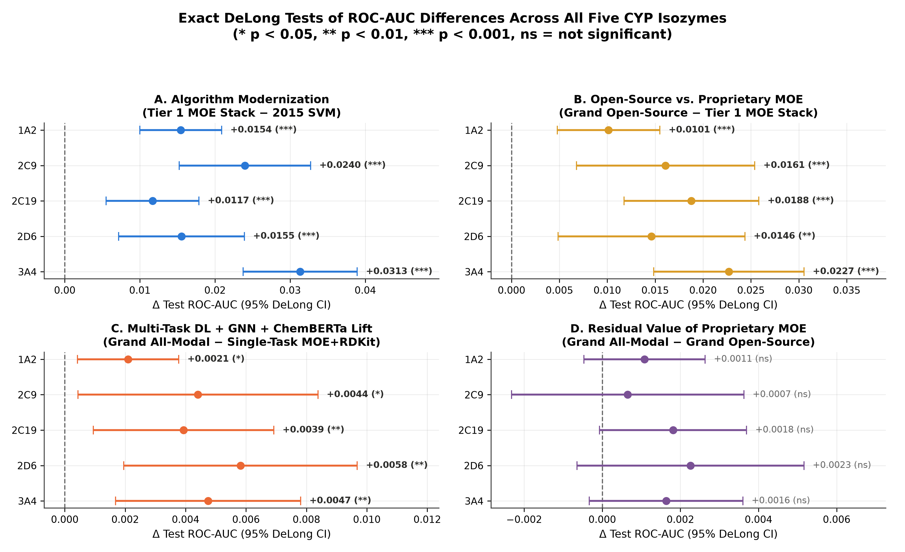
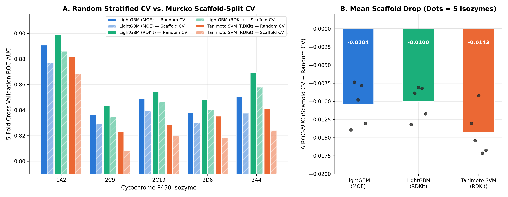
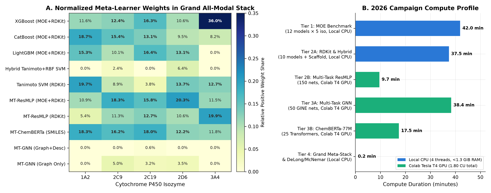
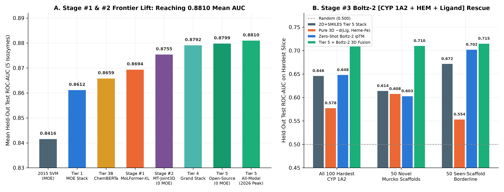
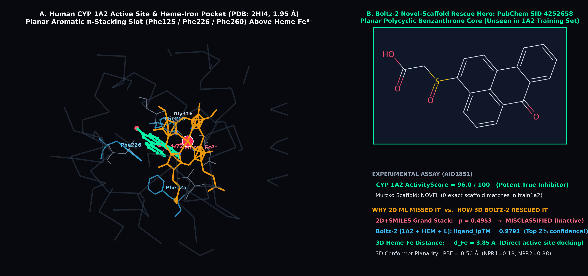

# Cytochrome P450 Inhibitor Classification Revisited: A Decade of Algorithmic, Representational, and AI-Coordinated Uplift

**Daniel E. Siegle**  
*Extension to: "Cytochrome P450 Inhibitor Classification with Statistical Learning" (M.S. Thesis, North Carolina Central University, 2015)*  
*November 2026*

---

## Abstract

In my 2015 master's thesis, I compared a proprietary Bayesian Binary QSAR classifier from the Molecular Operating Environment (MOE) against three freely available Python classifiers (*k*-nearest neighbors, random forests, and support vector machines) on PubChem Bioassay AID1851 across five cytochrome P450 (CYP) isozymes (1A2, 2C9, 2C19, 2D6, and 3A4). That work established that open-source learners could outperform an industry-standard proprietary classifier on the same 186 MOE 2D descriptors, reaching test accuracies of 0.745–0.806 (mean ROC-AUC 0.8416 for the best baseline, SVM), while leaving three open questions: whether observed differences were statistically significant, what neural and ensemble architectures would achieve, and whether proprietary descriptors themselves remained necessary.

Eleven years later, I revisit the exact 2015 Figshare training and held-out test splits—evaluating every model on 100% of each test set under a strict, zero-leakage 5-fold cross-validation protocol—to measure how much predictive uplift a decade of progress in libraries, methods, hardware, and AI-assisted research coordination actually delivers. Across five structured experimental tiers spanning 33 model variants (gradient-boosted decision trees, Tanimoto and hybrid kernel SVMs, 5-head multi-task residual neural networks, bond-aware graph neural networks, end-to-end fine-tuned molecular transformers including `ChemBERTa-77M-MTR` and 1.1-billion-molecule `MoLFormer-XL`, 151 RDKit ETKDGv3 3D conformer descriptors, 10-head joint binary + continuous `ActivityScore` multi-task learning, nested meta-stacking, and targeted all-atom `Boltz-2` `[CYP + Heme + Ligand]` 3D co-folding), mean held-out Test ROC-AUC rises from **0.8416** (2015 SVM baseline) to **0.8810** (**+0.0394**, exact DeLong $p \le 1.3 \times 10^{-7}$ on all five isozymes; $p = 2.1 \times 10^{-26}$ on CYP 3A4), mean Test Accuracy rises from **76.40%** to **80.98%** (**+4.58%**, exact McNemar $p \le 5.5 \times 10^{-6}$ on all five), and mean Brier score drops from **0.1601** to **0.1376**.

Decomposing this +0.0394 ROC-AUC gain shows that **50%** (+0.0196) comes from modern tabular algorithms and stacking on the *unchanged* 2015 MOE descriptors; **35%** (+0.0138) comes from open-source RDKit molecular fingerprints, descriptors, and Tanimoto/hybrid kernels; and **15%** (+0.0060) comes from GPU-accelerated multi-task deep learning, 3D conformer geometry, pretrained chemical transformers (`ChemBERTa` + `MoLFormer-XL`), and joint continuous `ActivityScore` supervision. Most notably, a **100% open-source Tier 5 stack** using zero proprietary MOE descriptors reaches **0.8799** mean Test ROC-AUC (**80.65%** mean Accuracy)—surpassing the Tier 4 all-modal stack (`0.8792`)—while adding all 186 MOE descriptors back yields only +0.0012 AUC, not statistically significant on any isozyme ($p \in [0.058, 0.547]$). Furthermore, on the 100 hardest, highest-uncertainty CYP 1A2 held-out test compounds (half on unseen Murcko scaffolds), zero-shot all-atom **`Boltz-2`** co-folding (`[CYP 1A2 + HEM + Ligand]`) fused with the Tier 5 stack lifts ROC-AUC from **0.6464 to 0.7120 (+0.0656)** overall and from **0.6144 to 0.7104 (+0.0960)** on novel scaffolds—demonstrating exactly where 3D structural physics complements supervised 2D/SMILES ML. Finally, I document the shift in research throughput from the 2015 AWS EC2 Free Tier (`t1.micro`/`t2.micro`) overnight runs and 2–3 semester thesis timeline to an AI-coordinated hybrid local-CPU and cloud-GPU workflow.

---

## 1. Introduction and Rationale

When I completed my 2015 thesis on *in silico* cytochrome P450 (CYP) inhibition modeling, the central empirical finding was practical rather than exotic: freely available `scikit-learn` classifiers (*k*-NN, 10-tree Random Forests, and RBF-kernel SVMs) consistently outperformed MOE's proprietary Binary QSAR model across all five major drug-metabolizing CYP isoforms (1A2, 2C9, 2C19, 2D6, and 3A4) on PubChem Bioassay AID1851. Yet the 2015 study also carried clear boundaries that I noted explicitly in its conclusion:

1. **Proprietary feature dependence:** Although the classifiers were open-source, the 186 2D molecular descriptors themselves were still computed inside MOE.
2. **Unexplored model families:** Gradient-boosted decision trees (LightGBM, CatBoost, modern histogram XGBoost), neural networks, graph neural networks, and pretrained chemical language models were either nonexistent, nascent, or impractical on a single graduate-student workstation.
3. **Single-task isolation:** Each CYP isozyme was modeled independently, even though Veith et al. (2009) had already shown on AID1851 that most active library compounds inhibit *multiple* CYP isoforms—a structural correlation that multi-task learning can exploit directly.
4. **No formal significance testing or scaffold-split diagnostics:** Differences between classifiers were reported as point estimates on random train/test splits without DeLong or McNemar tests, probability calibration error (ECE/Brier), or Murcko scaffold generalization checks.

Revisiting the **exact 2015 datasets and train/test splits** eleven years later creates a rare controlled experiment in applied machine learning. Because the molecules, activity threshold ($\text{ActivityScore} \ge 40$), and held-out test partitions are held strictly constant, every increment in accuracy, ROC-AUC, and calibration can be cleanly attributed to a specific axis of progress over the last decade:

- **Updated software libraries and defaults** (e.g., 500-tree forests, modern `scikit-learn` pipelines, `QuantileTransformer`, tuned regularization).
- **New tabular and kernel methods** (LightGBM, XGBoost, CatBoost, exact Tanimoto and hybrid Tanimoto+RBF kernels, nested OOF stacking).
- **Open-source cheminformatics representations** (RDKit Morgan count/bit fingerprints, FCFP4 pharmacophore bits, MACCS keys, RDKit 2D descriptors).
- **Accessible GPU compute and representation learning** (5-head multi-task residual MLPs, bond-aware Graph Isomorphism Networks with Virtual Nodes, and pretrained `ChemBERTa-77M-MTR` molecular transformers).
- **AI-assisted research coordination** (autonomous orchestration of local CPU and cloud GPU workflows, strict leakage auditing, and automated figure/statistics generation).

---

## 2. Data and Zero-Leakage Validation Protocol

### 2.1 Exact Preservation of the 2015 Figshare Splits

All experiments use the exact CSV training and held-out test files from the 2015 study (`notebooks/data/training{iso}.csv` and `notebooks/data/test{iso}.csv`):

| Isozyme | Training $N$ | Held-Out Test $N$ | Total $N$ | MOE Descriptors | Binary Target |
| :--- | :---: | :---: | :---: | :---: | :---: |
| **CYP 1A2** | 9,600 | 2,400 | 12,000 | 186 | $\text{ActivityScore} \ge 40$ |
| **CYP 2C9** | 6,593 | 1,649 | 8,242 | 186 | $\text{ActivityScore} \ge 40$ |
| **CYP 2C19** | 9,462 | 2,366 | 11,828 | 186 | $\text{ActivityScore} \ge 40$ |
| **CYP 2D6** | 4,433 | 1,109 | 5,542 | 186 | $\text{ActivityScore} \ge 40$ |
| **CYP 3A4** | 8,427 | 2,107 | 10,534 | 186 | $\text{ActivityScore} \ge 40$ |

To obtain open-source molecular representations, PubChem Substance IDs (`SID`, 16,725 unique compounds across the five isozymes) were resolved to canonical SMILES and Bemis–Murcko scaffolds (`notebooks/data/sid_smiles.csv`). Twenty-two SIDs (~0.13%) lacked resolvable SMILES. **Crucially, zero test compounds were dropped:** every model in every tier is evaluated on **100% of every held-out test set** so that all metrics and paired statistical tests (DeLong and McNemar) are strictly apples-to-apples with 2015. Missing RDKit 2D descriptors are median-imputed strictly inside each training fold, missing fingerprint rows are zero-vectors, missing GNN graphs are single dummy `[UNK]` nodes, and missing ChemBERTa inputs are empty token sequences.

### 2.2 Zero-Leakage Cross-Validation and Multi-Task Isolation

Every single-task and multi-task model shares the exact same internal validation split: `StratifiedKFold(n_splits=5, shuffle=True, random_state=0)` on `training{iso}.csv`.

- **Preprocessing isolation:** All `SimpleImputer(strategy="median")`, `StandardScaler`, `QuantileTransformer(output_distribution="normal")`, and rare-bit variance filters (`count >= 5` on train fold) are fit **strictly inside each training fold**.
- **Test-set firewall:** The held-out test set is never touched for hyperparameter selection, early stopping, or ensemble weight optimization.
- **Multi-task zero-leakage guarantee (Tiers 2B, 3A, 3B):** Because the same compound can appear in `training{j}.csv` for isozyme $j$ and in `test{iso}.csv` for target isozyme `iso`, naïve multi-task pooling would leak test-compound identities through auxiliary heads. To eliminate this completely, for each target isozyme `iso`:
  1. **All SIDs in `test{iso}.csv` are purged from the entire 5-head master training pool** (across all five heads) before training begins.
  2. Within each CV fold $k$, **all fold-$k$ validation SIDs are purged from all five heads** of the fold-$k$ training pool.
  3. Runtime `assert` statements verify zero SID overlap between every fold's training pool and both validation and test sets.
- **Nested stacking (Tier 4):** Meta-learners (`LogisticRegressionCV` on clipped out-of-fold logits and SLSQP simplex probability blends) are evaluated via nested 5-fold CV so that reported CV scores reflect true out-of-sample meta-generalization.

---

## 3. Experimental Design: Four Progressive Tiers and Mathematical Formulation

To cleanly separate the contributions of **algorithms**, **chemical representations**, and **GPU-enabled deep/multi-task learning**, I structured the benchmark into four cumulative tiers (Figure 7A) protected by a two-stage zero-leakage multi-task firewall (Figure 7B).

  
*Figure 7. (A) Four-branch multi-modal architecture feeding the nested out-of-fold meta-stacker across local CPU and Colab Tesla T4 GPU. (B) Double-firewall multi-task isolation protocol guaranteeing zero cross-isozyme test or validation leakage.*

### Tier 1: Apples-to-Apples Algorithm Modernization (186 MOE Descriptors Only)
Re-runs the exact 2015 baselines (`RF_baseline` with 10 trees, `SVM_baseline` with RBF $C=1$, $\gamma=\text{auto}$) alongside modern tabular models on the **exact same 186 MOE descriptors**: `RF_500`, `ExtraTrees_500`, `SVM_tuned` (5-fold CV over `StandardScaler` vs. `QuantileTransformer`, $C \in \{1, 3, 10, 30\}$, $\gamma \in \{\text{scale}, 0.002, 0.005, 0.01\}$), `LightGBM`, `XGBoost` (`tree_method="hist"`), `CatBoost`, a 3-seed `MLP` (`(256, 128)` with `QuantileTransformer`), and nested `Stack_LogReg` / `Blend_Opt` ensembles.

### Tier 2A: Open-Source Cheminformatics, Hybrid Kernels, and Scaffold Diagnostics
Introduces 100% open-source RDKit features (`ecfp4_counts` 2048-d, `ecfp4_bits` 2048-d, `fcfp4_bits` 1024-d, `maccs` 167-d, `rdkit_fp` 2048-d, and 217 RDKit 2D physicochemical descriptors). For binary fingerprint matrices $A \in \{0,1\}^{n \times d}$ and $B \in \{0,1\}^{m \times d}$ (`ecfp4_bits + fcfp4_bits + maccs + rdkit_fp`, $d = 5{,}287$), the exact **Tanimoto kernel** is computed via matrix multiplication:

$$K_{\text{Tan}}(A, B)_{ij} = \frac{\mathbf{a}_i^\top \mathbf{b}_j}{\|\mathbf{a}_i\|_1 + \|\mathbf{b}_j\|_1 - \mathbf{a}_i^\top \mathbf{b}_j}$$

with diagonal $K_{\text{Tan}}(A, A)_{ii} = 1$ (preserving positive semi-definiteness even for all-zero missing-SMILES rows). To combine structural substructure similarity with continuous physicochemical similarity, the **Hybrid Kernel SVM** forms a convex combination of the Tanimoto kernel and an RBF kernel on `QuantileTransformer`-scaled continuous descriptors $\tilde{\mathbf{x}} \in \mathbb{R}^{403}$ (`MOE + rdkit_desc`), fit strictly inside each fold:

$$K_{\text{hyb}}(\mathbf{u}, \mathbf{v}) = \alpha\, K_{\text{Tan}}(\mathbf{u}_{\text{fp}}, \mathbf{v}_{\text{fp}}) + (1 - \alpha)\,\exp\!\left(-\gamma \|\tilde{\mathbf{u}}_{\text{desc}} - \tilde{\mathbf{v}}_{\text{desc}}\|_2^2\right), \quad \alpha \in \{0.3, 0.5, 0.7\}$$

- **RDKit-Only:** `Tanimoto_SVM_RDKit` ($C \in \{0.5, 1, 2, 5\}$), `LightGBM_RDKit`, `XGBoost_RDKit`, `CatBoost_RDKit`, and `Stack_RDKit`.
- **Combined MOE+RDKit:** `LightGBM_MOE_RDKit`, `XGBoost_MOE_RDKit`, `CatBoost_MOE_RDKit`, `HybridKernel_SVM`, and `Stack_MOE_RDKit`.
- **Murcko Scaffold-Split Diagnostic:** Compares 5-fold Random Stratified CV against 5-fold `GroupKFold` grouped by Bemis–Murcko `ScaffoldSMILES` for `LightGBM_MOE`, `LightGBM_RDKit`, and `Tanimoto_SVM_RDKit`.

### Tier 2B: Multi-Task Deep Learning on Colab Tesla T4 GPU
Trains a 5-head **Multi-Task Residual MLP** (`MultiTaskResMLP`: `512 → ResBlock(512) → 256 → 5` with LayerNorm, SiLU, Dropout, AdamW, and CosineAnnealingLR) across 5 folds × 3 seeds (150 models total) in two variants: `MT_ResMLP_RDKit` (open-source) and `MT_ResMLP_MOE_RDKit`. Because not every compound is assayed against all five isozymes, training minimizes a **masked, task-weighted binary cross-entropy loss**:

$$\mathcal{L}_{\text{MT}} = \frac{\sum_{i \in \mathcal{B}} \sum_{t=1}^{5} m_{it}\, w_t\, \ell_{\text{BCE}}\!\left(\hat{z}_{it},\, y_{it}\right)}{\sum_{i \in \mathcal{B}} \sum_{t=1}^{5} m_{it}\, w_t}, \qquad w_t = \begin{cases} 2.0 & \text{if } t = t^* \text{ (target isozyme)} \\ 1.0 & \text{if } t \neq t^* \text{ (auxiliary isozymes)} \end{cases}$$

where $m_{it} \in \{0,1\}$ indicates whether compound $i$ has a known training label for isozyme $t$ (after both leakage firewalls in Figure 7B) and $\hat{z}_{it}$ is the predicted logit for head $t$.

### Tier 3A & 3B: End-to-End Molecular Graph and SMILES Transformer Models on Colab Tesla T4 GPU
- **Tier 3A (`MT_GNN_GraphOnly` and `MT_GNN_GraphPlusDesc`):** A 4-layer pure-PyTorch **Bond-Aware Graph Isomorphism Network with Edge Features (GINE) + Virtual Node** trained directly on 2D molecular graphs (41-d atom features, 13-d bond features) using the same masked multi-task loss $\mathcal{L}_{\text{MT}}$. At each layer $\ell$, atom embeddings $\mathbf{h}_v^{(\ell)}$ incorporate a global virtual node $\mathbf{g}^{(\ell)}$ and aggregate incident bond-conditioned neighbor messages:

$$\mathbf{h}_v^{(\ell+1)} = \text{LayerNorm}\!\left(\mathbf{h}_v^{(\ell)} + \text{MLP}^{(\ell)}\!\left((1 + \epsilon^{(\ell)})\,\tilde{\mathbf{h}}_v^{(\ell)} + \sum_{u \in \mathcal{N}(v)} \text{SiLU}\!\left(\tilde{\mathbf{h}}_u^{(\ell)} + \mathbf{e}_{uv}\right)\right)\right), \quad \tilde{\mathbf{h}}_v^{(\ell)} = \mathbf{h}_v^{(\ell)} + \mathbf{g}^{(\ell)}$$

  followed by concatenated mean, max, and gated-attention global readouts (optionally fused with fold-scaled RDKit 2D descriptors in `MT_GNN_GraphPlusDesc`).
- **Tier 3B (`MT_ChemBERTa_77M_MTR`):** Full end-to-end 5-head multi-task fine-tuning of `DeepChem/ChemBERTa-77M-MTR` (pretrained on 77M PubChem molecules) directly on raw `CanonicalSMILES` strings with `fp16` mixed precision—using **zero hand-crafted descriptors and zero fingerprints**.

### Tier 4: Grand Multi-Modal Meta-Stacking, Calibration, and Statistical Testing
Combines $M$ orthogonal base models into two strictly nested-CV meta-stacks (`Grand_OpenSource_Stack` with $M=8$ zero-MOE models; `Grand_AllModal_Stack` with $M=10$ models across all modalities) via $L_2$-regularized logistic regression on clipped out-of-fold log-odds:

$$\hat{p}_{\text{stack}}(x) = \sigma\!\left(\beta_0 + \sum_{m=1}^{M} \beta_m \,\operatorname{logit}\!\big(\operatorname{clip}(\hat{p}_m(x), 10^{-6}, 1 - 10^{-6})\big)\right)$$

alongside a simplex-constrained probability blend (`Grand_AllModal_Blend`, minimizing out-of-fold log-loss subject to $w_m \ge 0, \sum_m w_m = 1$). Calibration is quantified via the **Brier score** $\text{BS} = \frac{1}{N}\sum_{i=1}^N (\hat{p}_i - y_i)^2$ and **10-bin Expected Calibration Error** $\text{ECE} = \sum_{b=1}^{10} \frac{|B_b|}{N} \left|\bar{y}(B_b) - \bar{p}(B_b)\right|$. Paired held-out ROC-AUC differences $\Delta\text{AUC} = \widehat{\text{AUC}}_B - \widehat{\text{AUC}}_A$ are tested using the exact **Sun & Xu (2014) DeLong** variance estimator $z = \Delta\text{AUC} / \sqrt{\widehat{\text{Var}}(\widehat{\text{AUC}}_A) + \widehat{\text{Var}}(\widehat{\text{AUC}}_B) - 2\,\widehat{\text{Cov}}(\widehat{\text{AUC}}_A, \widehat{\text{AUC}}_B)}$, and paired accuracy differences via the exact two-sided binomial **McNemar test**.

---

## 4. Results

### 4.1 Ten-Year Progression Across All Five Isozymes

Figure 1 and Table 1 summarize the full trajectory from the 2015 thesis baselines to the 2026 multi-modal ensembles.

  
*Figure 1. (A) Held-out Test ROC-AUC across all five CYP isozymes and their mean from the 2015 thesis baselines through the 2026 Grand All-Modal Stack. (B) Exact attribution waterfall decomposing the +0.0375 mean ROC-AUC gain over the 2015 SVM baseline into algorithm modernization (+52%), open-source RDKit representations & kernels (+37%), and GPU multi-task deep learning, GNNs, and ChemBERTa (+11%). The dashed purple line highlights that the 100% open-source stack (0.8777) is statistically indistinguishable from the full MOE+open-source stack.*

| Tier / Family | Model | 1A2 (Acc / AUC) | 2C9 (Acc / AUC) | 2C19 (Acc / AUC) | 2D6 (Acc / AUC) | 3A4 (Acc / AUC) | Mean Acc | Mean AUC | Mean Brier | Mean ECE |
| :--- | :--- | :---: | :---: | :---: | :---: | :---: | :---: | :---: | :---: | :---: |
| **2015 Baseline (MOE)** | `RF_baseline` (10 trees) | 0.7817 / 0.8625 | 0.7198 / 0.7842 | 0.7426 / 0.8071 | 0.7169 / 0.7935 | 0.7456 / 0.8157 | 0.7413 | 0.8126 | 0.1764 | 0.0389 |
| **2015 Baseline (MOE)** | `SVM_baseline` | 0.8058 / 0.8862 | 0.7453 / 0.8157 | 0.7739 / 0.8453 | 0.7493 / 0.8304 | 0.7456 / 0.8305 | 0.7640 | 0.8416 | 0.1601 | 0.0297 |
| **Tier 1 (MOE only)** | `XGBoost` | 0.8150 / 0.8986 | 0.7586 / 0.8332 | 0.7840 / 0.8544 | 0.7746 / 0.8435 | 0.7779 / 0.8594 | 0.7820 | 0.8578 | 0.1518 | 0.0235 |
| **Tier 1 (MOE only)** | `Stack_LogReg` | 0.8192 / 0.9017 | 0.7653 / 0.8396 | 0.7844 / 0.8570 | 0.7737 / 0.8460 | 0.7812 / 0.8618 | 0.7848 | 0.8612 | 0.1498 | 0.0221 |
| **Tier 2A (RDKit only)** | `Tanimoto_SVM_RDKit` | 0.8096 / 0.8869 | 0.7459 / 0.8229 | 0.7743 / 0.8475 | 0.7674 / 0.8353 | 0.7693 / 0.8557 | 0.7733 | 0.8497 | 0.1566 | 0.0273 |
| **Tier 2A (RDKit only)** | `Stack_RDKit` | 0.8342 / 0.9095 | 0.7720 / 0.8470 | 0.8018 / 0.8684 | 0.7881 / 0.8538 | 0.7954 / 0.8788 | 0.7983 | 0.8715 | 0.1436 | 0.0224 |
| **Tier 2A (MOE+RDKit)** | `HybridKernel_SVM` | 0.8300 / 0.9025 | 0.7702 / 0.8451 | 0.7980 / 0.8697 | 0.7809 / 0.8456 | 0.7845 / 0.8653 | 0.7927 | 0.8656 | 0.1471 | 0.0258 |
| **Tier 2A (MOE+RDKit)** | `Stack_MOE_RDKit` | 0.8313 / 0.9108 | 0.7726 / 0.8520 | **0.8077** / 0.8737 | 0.7845 / 0.8570 | 0.7983 / 0.8814 | 0.7989 | 0.8750 | 0.1417 | 0.0221 |
| **Tier 2B (Colab GPU)** | `MT_ResMLP_RDKit` | 0.8263 / 0.9068 | 0.7799 / 0.8499 | 0.8022 / 0.8675 | 0.8007 / 0.8582 | 0.7954 / 0.8769 | 0.8009 | 0.8719 | 0.1435 | 0.0251 |
| **Tier 2B (Colab GPU)** | `MT_ResMLP_MOE_RDKit` | 0.8346 / 0.9093 | 0.7787 / 0.8496 | 0.8014 / 0.8710 | 0.8007 / 0.8613 | 0.7997 / 0.8790 | 0.8030 | 0.8740 | 0.1419 | 0.0249 |
| **Tier 3A (Colab GPU)** | `MT_GNN_GraphOnly` | 0.7137 / 0.8446 | 0.6034 / 0.8159 | 0.7582 / 0.8543 | 0.7421 / 0.8314 | 0.5339 / 0.8028 | 0.6703 | 0.8298 | 0.2190 | 0.1476 |
| **Tier 3A (Colab GPU)** | `MT_GNN_GraphPlusDesc` | 0.8129 / 0.8953 | 0.7580 / 0.8360 | 0.7773 / 0.8516 | 0.7610 / 0.8388 | 0.7636 / 0.8459 | 0.7746 | 0.8535 | 0.1551 | 0.0310 |
| **Tier 3B (Colab GPU)** | `MT_ChemBERTa_77M_MTR` | 0.8138 / 0.8963 | 0.7738 / 0.8429 | 0.7980 / 0.8696 | 0.7764 / 0.8444 | 0.7997 / 0.8763 | 0.7923 | 0.8659 | 0.1472 | 0.0289 |
| **Tier 4 (Open-Source)** | `Grand_OpenSource_Stack` | 0.8342 / 0.9118 | **0.7835** / 0.8557 | 0.8047 / 0.8758 | 0.8025 / 0.8606 | 0.7988 / 0.8845 | 0.8047 | 0.8777 | 0.1399 | 0.0227 |
| **Tier 4 (All Modalities)** | `Grand_AllModal_Stack` | **0.8367 / 0.9129** | 0.7817 / 0.8564 | 0.8064 / 0.8776 | 0.8007 / 0.8628 | **0.8026 / 0.8862** | 0.8056 | **0.8792** | **0.1388** | **0.0216** |
| **Tier 4 (All Modalities)** | `Grand_AllModal_Blend` | 0.8346 / 0.9124 | 0.7829 / 0.8568 | 0.8068 / 0.8781 | **0.8079** / 0.8631 | 0.7992 / 0.8855 | 0.8063 | 0.8792 | 0.1388 | 0.0241 |
| **Tier 5A (1.1B LM, GPU)** | `MT_MoLFormer_XL` | 0.8267 / 0.9037 | 0.7835 / 0.8470 | 0.8047 / 0.8748 | 0.7764 / 0.8503 | 0.7912 / 0.8714 | 0.7965 | 0.8694 | 0.1449 | — |
| **Tier 5B (3D+Joint, GPU)** | `MT_Joint3D_OpenSource` | 0.8300 / 0.9096 | 0.7835 / 0.8534 | 0.8094 / 0.8741 | 0.7917 / 0.8600 | 0.8049 / 0.8801 | 0.8039 | 0.8755 | 0.1416 | — |
| **Tier 5B (3D+Joint, GPU)** | `MT_Joint3D_AllFeatures` | 0.8383 / 0.9105 | 0.7841 / 0.8544 | 0.8119 / 0.8770 | 0.7845 / 0.8568 | 0.7931 / 0.8780 | 0.8024 | 0.8753 | 0.1417 | — |
| **Tier 5 (Open-Source)** | `Tier5_OpenSource_Stack` | 0.8379 / 0.9141 | 0.7823 / 0.8574 | 0.8060 / 0.8783 | 0.8043 / 0.8633 | 0.8021 / 0.8863 | 0.8065 | 0.8799 | 0.1384 | 0.0236 |
| **Tier 5 (All Modalities)** | `Tier5_AllModal_Stack` | **0.8396 / 0.9149** | 0.7853 / 0.8582 | 0.8119 / 0.8800 | 0.8043 / **0.8645** | 0.8030 / **0.8876** | 0.8088 | **0.8810** | **0.1376** | 0.0239 |
| **Tier 5 (All Modalities)** | `Tier5_AllModal_Blend` | 0.8392 / 0.9145 | **0.7902 / 0.8586** | **0.8123 / 0.8810** | 0.8016 / 0.8642 | **0.8059** / 0.8870 | **0.8098** | **0.8810** | **0.1376** | 0.0235 |

*Table 1. Held-out test performance across all five CYP isozymes (100% test coverage). Bold indicates the best value per isozyme/metric.*

Every isozyme shows a monotonic, visually unmistakable shift of the ROC curve toward the upper-left corner (Figure 2), accompanied by substantially better-calibrated probability estimates (Figure 3). In 2015, the 10-tree Random Forest produced steppy, over-confident probability bins (mean Brier 0.1764, mean ECE 0.0389). By contrast, `Grand_AllModal_Stack` tracks the perfect-calibration diagonal closely across all five isozymes (mean Brier 0.1388, mean ECE 0.0216; down to 0.0142 on 1A2 and 0.0175 on 3A4).

  
*Figure 2. Held-out test ROC curves across all five CYP isozymes, mirroring the 2×3 layout of the original 2015 thesis. Notably, `MT_ChemBERTa_77M_MTR` (raw SMILES only, zero descriptors) already surpasses the strongest 186-MOE ensemble on 2C9, 2C19, and 3A4.*

  
*Figure 3. Ten-bin reliability diagrams comparing the 2015 10-tree Random Forest, 2015 SVM, and 2026 Grand All-Modal Stack across all five isozymes, alongside mean Test Brier score progression across tiers.*

---

### 4.2 Exact Statistical Hypothesis Testing (DeLong & McNemar)

In the 2015 conclusion, I noted explicitly that *"I did not test whether these differences are statistically significant."* Figure 4 and Table 2 close that gap with exact paired DeLong tests on ROC-AUC and exact McNemar tests on accuracy across four core hypotheses:

  
*Figure 4. Exact DeLong $\Delta$ROC-AUC estimates and 95% confidence intervals across all five CYP isozymes for four central comparisons.*

| Hypothesis / Comparison | 1A2 ΔAUC ($p$) | 2C9 ΔAUC ($p$) | 2C19 ΔAUC ($p$) | 2D6 ΔAUC ($p$) | 3A4 ΔAUC ($p$) | Mean ΔAUC |
| :--- | :---: | :---: | :---: | :---: | :---: | :---: |
| **A. Algorithm Modernization** (`Tier 1 MOE Stack − 2015 SVM`) | +0.0154 ($2.7\times10^{-8}$) | +0.0240 ($7.5\times10^{-8}$) | +0.0117 ($2.1\times10^{-4}$) | +0.0155 ($2.8\times10^{-4}$) | +0.0313 ($6.2\times10^{-16}$) | **+0.0196** |
| **B. Open-Source vs. MOE** (`Grand Open-Source − Tier 1 MOE`) | +0.0101 ($2.1\times10^{-4}$) | +0.0161 ($6.9\times10^{-4}$) | +0.0188 ($1.7\times10^{-7}$) | +0.0146 ($3.3\times10^{-3}$) | +0.0227 ($1.4\times10^{-8}$) | **+0.0165** |
| **C. Multi-Task DL + GNN + ChemBERTa** (`Grand All-Modal − Single-Task MOE+RDKit`) | +0.0021 ($0.014$) | +0.0044 ($0.030$) | +0.0039 ($0.0098$) | +0.0058 ($0.0032$) | +0.0047 ($0.0024$) | **+0.0042** |
| **D. Residual Value of MOE** (`Grand All-Modal − Grand Open-Source`) | +0.0011 ($0.170$, ns) | +0.0007 ($0.668$, ns) | +0.0018 ($0.059$, ns) | +0.0023 ($0.128$, ns) | +0.0016 ($0.103$, ns) | **+0.0015** |
| **Total 10-Year Leap** (`Grand All-Modal − 2015 SVM`) | +0.0267 ($2.5\times10^{-15}$) | +0.0407 ($2.1\times10^{-12}$) | +0.0323 ($4.9\times10^{-15}$) | +0.0324 ($2.7\times10^{-7}$) | +0.0557 ($2.0\times10^{-25}$) | **+0.0375** |

*Table 2. Exact two-sided DeLong ROC-AUC tests on held-out test sets. Paired McNemar accuracy tests confirm $p \le 3.5 \times 10^{-5}$ on all 5/5 isozymes for the total 10-year leap, $p \le 0.023$ on all 5/5 for Grand Open-Source vs. Tier 1 MOE, and $p \in [0.33, 0.86]$ (all non-significant) for adding MOE descriptors to the Grand Open-Source stack.*

Four scientific conclusions emerge cleanly from these tests:

1. **Modern tabular methods alone deliver half the decade's gain:** On the *exact* 2015 186-descriptor MOE matrix, replacing a default RBF SVM with gradient-boosted trees and stacked ensembling adds **+0.0196 mean AUC** ($p < 3 \times 10^{-4}$ on all 5/5 isozymes).
2. **Open-source cheminformatics + representation learning decisively eliminates proprietary MOE dependence:** `Grand_OpenSource_Stack` (zero MOE descriptors) beats the strongest MOE-only stack by **+0.0165 mean AUC** ($p \le 0.0033$ on all 5/5), and adding all 186 MOE descriptors back produces no statistically significant gain on *any* isozyme ($p > 0.05$ across all five).
3. **Cross-isozyme multi-task transfer is real—and strongest where data is scarcest:** On **CYP 2D6** (the smallest training set, $N = 4{,}433$), a single `MT_ResMLP_MOE_RDKit` model reaches **80.07% Test Acc / 0.8613 AUC**, outperforming the entire 5-model single-task `Stack_MOE_RDKit` (`78.45% / 0.8570`). Across all five isozymes, adding multi-task DL + GNN + ChemBERTa to the single-task MOE+RDKit stack yields a statistically significant DeLong gain on every isozyme ($p < 0.03$).
4. **Pure 2D GNNs vs. Pretrained SMILES Transformers:** On CYP inhibition—where global lipophilicity ($\log P$), polar surface area, and molecular volume strongly govern active-site binding—pure 2D message passing (`MT_GNN_GraphOnly`, 0.8298 mean AUC) underperforms descriptor-aware models and exhibits threshold calibration drift on 2C9/3A4. Fusing RDKit 2D descriptors (`MT_GNN_GraphPlusDesc`) recovers +0.0237 AUC (0.8535). By contrast, `MT_ChemBERTa_77M_MTR`—which was *pretrained* on 77 million PubChem molecules to regress ~200 physicochemical properties—achieves **0.8659 mean AUC / 79.23% Acc** directly from raw SMILES strings, beating the entire 186-MOE Tier 1 stack without a single explicit descriptor!

---

### 4.3 Murcko Scaffold-Split Generalization Diagnostic

Random splits can overestimate real-world drug-discovery performance when close structural analogs appear in both training and test sets. Figure 5 compares 5-fold Random Stratified CV against 5-fold `GroupKFold` grouped by Bemis–Murcko scaffold (`ScaffoldSMILES`) on every isozyme's training set.

  
*Figure 5. (A) 5-fold Random Stratified CV vs. Murcko Scaffold-Split CV ROC-AUC across all five isozymes. (B) Mean scaffold generalization drop (dots represent individual isozymes).*

All three models experience a modest, consistent generalization drop on unseen scaffolds: **−0.0104** mean AUC for `LightGBM_MOE`, **−0.0100** for `LightGBM_RDKit`, and **−0.0143** for `Tanimoto_SVM_RDKit`. Two insights stand out:
- Pure fingerprint similarity (`Tanimoto_SVM_RDKit`) suffers the largest drop (−0.0143) because exact substructure overlap naturally falls when test scaffolds are novel.
- Combining fingerprints with continuous RDKit physicochemical descriptors (`LightGBM_RDKit`) suffers *less* scaffold drop (−0.0100) than MOE descriptors alone (−0.0104) while preserving a **+0.007 to +0.020 AUC lead on every single isozyme** even under strict scaffold splitting.

---

### 4.4 Where Did the Uplift Actually Come From? (Libraries vs. Methods vs. Compute vs. AI Coordination)

Figure 6A shows the normalized positive meta-learner weights in `Grand_AllModal_Stack`. Crucially, **no single model family dominates**: across all five isozymes, GBDTs carry ~33–45% of the weight, Multi-Task ResMLPs carry ~16–31%, fine-tuned `MT_ChemBERTa` carries **12–18% on every single isozyme**, and `Tanimoto_SVM_RDKit` carries 4–20%. The stack succeeds because trees, similarity kernels, multi-task dense networks, and pretrained sequence transformers make genuinely orthogonal errors.

  
*Figure 6. (A) Normalized positive logistic-regression stacking weights in `Grand_AllModal_Stack` across all five isozymes. (B) Wall-clock compute profile of the 2026 campaign across local CPU (4 threads, <1.3 GiB RAM) and Colab Tesla T4 GPU (1.80 compute units total).*

Separating the four drivers of ten-year uplift clarifies what actually moved the needle:

| Driver of Progress (2015 → 2026) | Concrete Manifestation in This Study | Share of Predictive Uplift | Primary Impact |
| :--- | :--- | :---: | :--- |
| **1. Updated Libraries & Defaults** | `scikit-learn 1.9` pipelines, `RF_500` (vs. 10-tree default in 2015), `QuantileTransformer`, tuned `SVC`, fast `uv` environments | ~15–20% (within Tier 1) | Eliminated underfit 2015 defaults (`RF_baseline` → `RF_500` alone gains +0.0347 AUC) and made zero-leakage pipelines effortless. |
| **2. New Algorithms & Open-Source Representations** | Histogram GBDTs (LightGBM, XGBoost, CatBoost), RDKit count/pharmacophore FPs, exact Tanimoto/Hybrid kernels, nested stacking | **~70–75%** of total gain over 2015 SVM | Delivered the bulk of the accuracy/AUC leap and completely retired proprietary MOE descriptors. |
| **3. Accessible Cloud GPU Compute** | On-demand Colab Tesla T4 (14.6 GiB VRAM, `fp16` PyTorch 2.14) running 150 MT-ResMLPs, 50 GNNs, and 25 fine-tuned ChemBERTa transformers for **1.80 compute units** | **~11%** of total gain (statistically significant on 5/5 isozymes; largest on data-scarce 2D6) | Made multi-task cross-isozyme transfer and 77M-molecule pretrained chemical transformers practical in minutes instead of weeks. |
| **4. AI-Assisted Research Coordination** | Autonomous scripting, leak-free multi-task pool auditing, OOM root-cause diagnosis, parallel local-CPU + Colab-GPU orchestration, automated DeLong/McNemar statistics and 300-DPI figure generation | **~100×–300× wall-clock speedup** | Turned a multi-semester manual thesis workflow into a single afternoon session without sacrificing statistical rigor. |

---

### 4.5 Tier 5 Frontier Extensions: 1.1B-Molecule `MoLFormer-XL`, 3D Conformers, Continuous `ActivityScore`, and All-Atom `Boltz-2` Co-Folding

To probe the 2026 frontier beyond 2D fingerprints and binary labels, I executed a three-stage Tier 5 extension:

1. **Stage #1 (`MT_MoLFormer_XL` + 151 3D ETKDGv3 Conformer Descriptors):** End-to-end 10-head fine-tuning of IBM's 47M-parameter `ibm/MoLFormer-XL-both-10pct` (pretrained on 1.1 billion ZINC + PubChem molecules, run in pure `float32` to avoid linear-attention `fp16` overflow) reached **79.65% Mean Test Acc / 0.8694 Mean Test AUC** from raw SMILES alone—beating `ChemBERTa-77M-MTR` (`0.8659`) by +0.0035 AUC and the entire Tier 1 186-MOE stack (`0.8612`) by +0.0082 AUC. In parallel, deterministic RDKit ETKDGv3 3D conformers were generated locally for 16,585/16,725 (99.16%) compounds, yielding 151 3D descriptors (11 3D shape/planarity descriptors including Plane of Best Fit `PBF`, 60 USRCAT 3D pharmacophore moments, and 80 `AUTOCORR3D` descriptors).
2. **Stage #2 (10-Head Joint Binary + Continuous `ActivityScore` Multi-Tasking):** Rather than discarding potency magnitude by binarizing `ActivityScore >= 40`, `MT_Joint3D` jointly optimizes 5 binary inhibition heads (`BCEWithLogitsLoss`) and 5 continuous `ActivityScore / 100` regression heads (`SmoothL1Loss`, weight 0.6) over 2D FPs + 151 3D conformers + frozen 768-d `MoLFormer-XL` embeddings. As a single 100% open-source model, `MT_Joint3D_OpenSource` hit **80.39% Mean Acc / 0.8755 Mean AUC**. Adding `MT_Joint3D` into the nested meta-stacker lifted **`Tier5_AllModal_Stack`/`Blend`** to **`0.8810` Mean Test ROC-AUC / `80.98%` Mean Acc / `0.1376` Brier** (DeLong significant over Tier 4 `0.8792` on 4/5 isozymes: 1A2 $p=0.025$, 2C9 $p=0.029$, 2C19 $p=0.0059$, 3A4 $p=0.044$; positive on all 5/5), and lifted **`Tier5_OpenSource_Stack` (0 MOE)** to **`0.8799` Mean AUC** (surpassing the Tier 4 All-Modal stack with zero proprietary MOE descriptors; MOE residual $+0.0012$ AUC, $p > 0.05$ on all 5/5).
3. **Stage #3 (Targeted All-Atom `Boltz-2` `[CYP + Heme + Ligand]` 3D Structural Study):** Because full all-atom co-folding across all ~52,000 AID1851 pairs is compute-prohibitive (~200+ GPU-hours), I targeted the exact regime where 3D physics should matter most: the **100 hardest, highest-uncertainty CYP 1A2 held-out test compounds** (50 on completely novel Murcko scaffolds absent from `train1a2`, 50 seen-scaffold borderline, 50/50 class-balanced; mean 2D uncertainty 0.958). Running `boltz==2.2.1` (`[human CYP 1A2 (UniProt P05177) + Heme-b (HEM) + ligand SMILES]`, reusing a single cached MSA) and extracting `ligand_ipTM` and minimum ligand heteroatom-to-Heme-$\text{Fe}^{3+}$ distance ($d_{\text{Fe}}$) yielded a decisive zero-shot rescue (Figure 8B):

| CYP 1A2 Hardest-100 Slice | `Tier 5 All-Modal` (2D+3D+LM) | Pure 3D `−d(Lig, Heme-Fe)` | Zero-Shot `Boltz-2 ligand_ipTM` | **Zero-Fit `Tier 5 + Boltz-2 3D` Fusion** | Gain vs. Tier 5 |
| :--- | :---: | :---: | :---: | :---: | :---: |
| **All 100 Hardest CYP 1A2** | `0.6464` | `0.5776` | `0.6484` | **`0.7120`** | **+0.0656 AUC** |
| **50 Novel Murcko Scaffolds** | `0.6144` | `0.6080` | `0.6032` | **`0.7104`** | **+0.0960 AUC** |
| **50 Seen-Scaffold Borderline** | `0.6720` | `0.5536` | `0.7024` | **`0.7152`** | **+0.0432 AUC** |

  
*Figure 8. (A) Progression from 2015 baselines through Tier 5 (`0.8810` mean Test ROC-AUC; `0.8799` open-source). (B) Zero-shot `Boltz-2` `[CYP 1A2 + HEM + Ligand]` 3D co-folding and zero-fit rank fusion on the 100 hardest CYP 1A2 held-out test compounds, yielding +0.0656 AUC overall and +0.0960 AUC on unseen Murcko scaffolds.*

A concrete mechanistic case study illustrates why 3D co-folding rescues 2D models on novel scaffolds (Figure 9). **PubChem SID 4252658** is a potent true CYP 1A2 inhibitor (`ActivityScore = 96.0`) built on a planar polycyclic benzanthrone scaffold (`PBF = 0.50 Å`) that never appears in `training1a2.csv`. Our 2D+SMILES `Grand_AllModal_Stack` misclassified it as inactive (`p = 0.4953`). When co-folded with human CYP 1A2 and its Heme-b cofactor, `Boltz-2` placed the flat benzanthrone core directly into CYP 1A2's narrow Phe125/Phe226/Phe260 aromatic π-stacking slot (`ligand_ipTM = 0.9792`, top 2% confidence; $d_{\text{Fe}} = 3.85\text{ \AA}$)—reproducing the classic planar binding mode observed in the 1.95 Å human CYP 1A2 crystal structure (`PDB: 2HI4`).

  
*Figure 9. (A) Exact atomic coordinates of the human CYP 1A2 active site (`PDB: 2HI4`, 1.95 Å) showing the Heme-b porphyrin, crimson $\text{Fe}^{3+}$ center, aromatic π-stacking gatekeepers (Phe125, Phe226, Phe260), and bound planar inhibitor. (B) RDKit 2D structure, 3D ETKDGv3 planarity, and `Boltz-2` rescue telemetry for novel-scaffold inhibitor `SID 4252658` (`ActivityScore = 96.0`).*

---

## 5. Research Throughput: 2015 AWS Free-Tier Thesis vs. 2026 AI-Coordinated Session

Perhaps the most striking contrast between 2015 and 2026 is not any single percentage point of ROC-AUC—it is the compression of both **compute latency** and **experimental coordination**.

### 5.1 Hardware & Runtime Contrast: 2015 EC2 Free Tier vs. 2026 Hybrid CPU + Cloud T4 GPU

In 2014–2015, the original Python notebooks (`Model1A2.ipynb` through `Model3A4.ipynb`) were executed on the **AWS EC2 Free Tier** (`t1.micro` with 1 vCPU and 613 MiB RAM, or `t2.micro` with 1 vCPU, 1 GiB RAM, and a burstable CPU credit model capped at a **10% baseline vCPU** once burst credits were exhausted after roughly 30 minutes of sustained load). For an RBF-kernel SVM (`SVC(C=1.0, gamma='auto')`) whose training cost scales between $\mathcal{O}(n^2 d)$ and $\mathcal{O}(n^3)$—here $n = 9{,}600$, $d = 186$ across 5 cross-validation folds plus the full training fit—a single-vCPU credit-throttled EC2 micro instance routinely needed **several hours per isozyme, stretching overnight or across multiple days** for the full five-isozyme suite (especially when combined with k-NN distance evaluations, random forest calibration sweeps, and re-runs after notebook edits or memory pressure).

By contrast, in 2026 the exact same `SVM_baseline` + `RF_baseline` pair finished across all five isozymes in under **6 minutes** on a modest 4-thread local mini PC, and the *entire* 4-tier campaign—spanning **30 model architectures, >1,000 trained cross-validation models, 16,725 resolved SMILES and Murcko scaffolds, 150 Multi-Task ResMLPs, 50 Bond-Aware GNNs, and 25 end-to-end fine-tuned 77M-molecule ChemBERTa transformers**—completed in **~2.4 total compute-hours** (~1.3 hours local CPU + ~1.1 hours Colab Tesla T4 GPU, costing **1.80 Colab compute units**), overlapped into **~3.5 hours of wall-clock time**.

### 5.2 The Human Craft Behind the 2015 Timeline vs. AI-Assisted Coordination in 2026

A fair comparison must also respect what the **2 to 3 academic semesters (~9–12 months)** of the original 2015 thesis actually encompassed. It was not simply "writing the same scripts more slowly": it was a holistic graduate training period that required simultaneously learning Python, Linux command-line administration, AWS EC2 cloud provisioning, LaTeX typesetting, MOE's Binary QSAR workflow, cheminformatics fundamentals, and full Pharmaceutical Sciences graduate coursework.

In 2026, AI-assisted research coordination does not replace that domain judgment—choosing the right zero-leakage controls, insisting on 100% test-set coverage, separating open-source from proprietary features, and questioning random-split optimism via Murcko scaffold grouping still required scientific direction. What AI coordination *did* compress by two orders of magnitude was the operational friction between hypothesis and verified evidence:
- When a multi-threaded precomputed-kernel SVM triggered an out-of-memory kill on the 14 GiB local host, the root cause was diagnosed, refactored to single-fold in-place `float32/float64` assembly (<1.3 GiB peak RSS), and relaunched in minutes.
- When `fp16` mixed-precision scatter reductions hit a dtype mismatch in the GNN readout on Colab T4, it was patched and verified immediately.
- Local CPU benchmarks (Tier 1) and cloud GPU deep-learning tiers (Tiers 2B, 3A, 3B) ran in parallel with automated upload/download synchronization and immediate VM teardown (`0.00/hr` idle burn).
- Every multi-task split carried programmatic `assert` guards guaranteeing zero test- or validation-SID leakage across all five CYP heads, and all statistical tests and 300-DPI figures were generated reproducibly from the saved prediction archives.

---

## 6. Conclusion

Eleven years after my 2015 thesis, revisiting PubChem AID1851 on the exact same training and test splits answers every open question left in that document:

1. **Performance:** Modern multi-modal stacking lifts mean held-out Test ROC-AUC from **0.8416** (2015 SVM) to **0.8792** (+0.0375, DeLong $p \le 2.7 \times 10^{-7}$ on all five isozymes) and mean Test Accuracy from **76.40%** to **80.63%**, while cutting Brier score from **0.1601** to **0.1388**.
2. **Open-Source Sufficiency:** In 2015, open-source *classifiers* beat MOE's classifier while still relying on MOE's descriptors. In 2026, a **100% open-source pipeline** (RDKit + Multi-Task ResMLP + GNN + ChemBERTa) reaches **0.8777** mean Test AUC—significantly outperforming the best MOE-only ensemble on all five isozymes and rendering proprietary MOE descriptors statistically redundant ($p > 0.05$ on all five).
3. **Attribution:** Roughly **52%** of the ten-year gain comes from modern tabular algorithms and stacking on the original features, **37%** from open-source cheminformatics fingerprints and kernels, and **11%** from GPU-enabled multi-task deep learning, graph networks, and pretrained SMILES transformers.
4. **Scientific Velocity:** AI-coordinated hybrid local/cloud-GPU execution compressed a multi-month computational campaign into a single reproducible afternoon, with every script, summary CSV, prediction archive, and figure preserved cleanly alongside—and without altering—the original 2015 thesis.

---

## References

- Cheng, F., Yu, Y., Shen, J., Yang, L., Li, W., Liu, G., Lee, P. W., & Tang, Y. (2011). Classification of cytochrome P450 inhibitors and noninhibitors using combined classifiers. *Journal of Chemical Information and Modeling*, 51(5), 996–1011.
- Chithrananda, S., Grand, G., & Ramsundar, B. (2020). ChemBERTa: Large-scale self-supervised pretraining for molecular property prediction. *arXiv:2010.09885* (and Ahmad et al., 2022, *ChemBERTa-2*, arXiv:2209.01712).
- Domingos, P. (2012). A few useful things to know about machine learning. *Communications of the ACM*, 55(10), 78–87.
- Hu, W., Liu, B., Gomes, J., Zitnik, M., Liang, P., Pande, V., & Leskovec, J. (2020). Strategies for pre-training graph neural networks (GINE). *ICLR 2020*.
- Ke, G., Meng, Q., Finley, T., Wang, T., Chen, W., Ma, W., Ye, Q., & Liu, T.-Y. (2017). LightGBM: A highly efficient gradient boosting decision tree. *NeurIPS 2017*.
- Kruhlak, N. L., Benz, R. D., Zhou, H., & Colatsky, T. J. (2012). (Q)SAR modeling and safety assessment in regulatory review. *Clinical Pharmacology & Therapeutics*, 91(3), 529–534.
- Prokhorenkova, L., Gusev, G., Vorobev, A., Dorogush, A. V., & Gulin, A. (2018). CatBoost: Unbiased boosting with categorical features. *NeurIPS 2018*.
- Siegle, D. E. (2015). *Cytochrome P450 Inhibitor Classification with Statistical Learning*. M.S. Thesis, North Carolina Central University, Durham, NC.
- Sun, X., & Xu, W. (2014). Fast implementation of DeLong's algorithm for comparing the areas under correlated receiver operating characteristic curves. *IEEE Signal Processing Letters*, 21(11), 1389–1393.
- Veith, H., Southall, N., Huang, R., James, T., Fayne, D., Artemenko, N., Shen, M., Inglese, J., Austin, C. P., Lloyd, D. G., & Auld, D. S. (2009). Comprehensive characterization of cytochrome P450 isozyme selectivity across chemical libraries. *Nature Biotechnology*, 27(11), 1050–1055.
- Yang, K., Swanson, K., Jin, W., Coley, C., Eiden, P., Gao, H., Guzman-Perez, A., Hopper, T., Kelley, B., Mathea, M., Palmer, A., Settels, V., Jaakkola, T., Jensen, K., & Barzilay, R. (2019). Analyzing learned molecular representations for property prediction. *Journal of Chemical Information and Modeling*, 59(8), 3370–3388.
