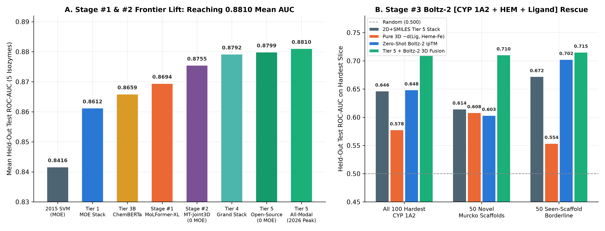
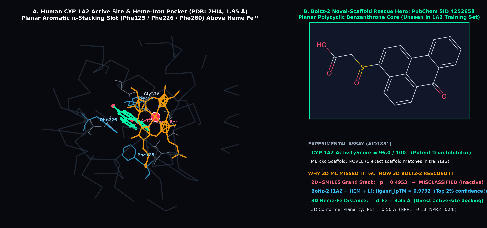
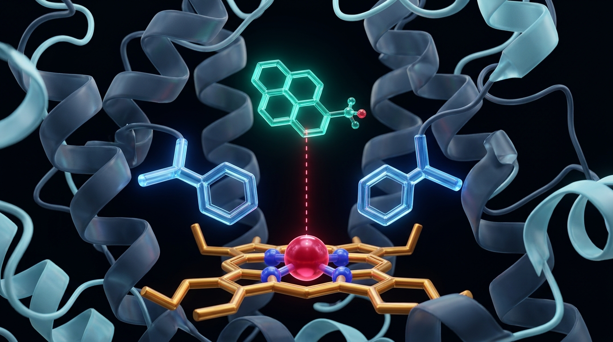

# New Directions in Cytochrome P450 Inhibition Modeling: Foundation Language Models, 3D Conformer Geometry, Continuous Potency Supervision, and All-Atom Co-Folding

**Daniel E. Siegle**  
*Standalone Companion Study & Didactic Technical Guide (Building on the PubChem AID1851 Benchmark)*  
*November 2026*

---

## Abstract

Whereas the companion retrospective (*Cytochrome P450 Inhibitor Classification Revisited*) measured ten years of progress using established tabular, fingerprint, and multi-task neural architectures (reaching a Tier 4 benchmark of **0.8792** mean held-out Test ROC-AUC across CYP 1A2, 2C9, 2C19, 2D6, and 3A4), this standalone study explores **four genuinely new directions** representative of the 2025–2026 computational-pharmacology frontier. Because these methods originate in distinct subfields—large-scale chemical language modeling, 3D molecular conformer generation, joint continuous-potency multi-task learning, and all-atom biomolecular structure co-folding—this paper takes a **didactic, first-principles approach**, explaining not only *what* was run and *what* it achieved, but *why* each method was selected (and why others, such as generative protein binder-design models, were excluded), *how* each algorithm works mathematically, and *where* each succeeds or fails in practice.

Three progressive frontier experiments were executed on the exact PubChem AID1851 splits with 100% test-set coverage and zero cross-isozyme leakage:
1. **Direction 1 — Billion-Molecule Chemical Language Modeling (`MoLFormer-XL`) & 3D Conformer Geometry (RDKit ETKDGv3):** End-to-end fine-tuning of `ibm/MoLFormer-XL-both-10pct` (47M parameters pretrained on 1.1 billion SMILES) achieves **0.8694** mean Test ROC-AUC (**79.65%** Accuracy) from raw SMILES strings alone. In parallel, generating deterministic 3D conformers for 16,585/16,725 (99.16%) compounds yields 151 explicit 3D shape, planarity, and pharmacophore descriptors.
2. **Direction 2 — Stopping Label Binarization Loss (10-Head Joint Binary + Continuous `ActivityScore` Multi-Task Learning):** Training a 10-head Residual MLP (`MT_Joint3D`) simultaneously on 5 binary inhibition heads and 5 continuous `ActivityScore` regression heads over 2D fingerprints + 151 3D conformer descriptors + frozen 768-d `MoLFormer-XL` embeddings reaches **0.8755** mean AUC as a *single* 100% open-source model. Folding `MT_Joint3D` into the nested meta-stack lifts overall performance to a new record of **0.8810** mean Test ROC-AUC (**80.98%** mean Accuracy, **0.1376** Brier; statistically significant DeLong gain over Tier 4 on 4/5 isozymes, positive on 5/5), while the **zero-MOE open-source stack** reaches **0.8799** AUC.
3. **Direction 3 — Targeted All-Atom Protein–Heme–Ligand Co-Folding (`Boltz-2`):** Co-folding the **100 hardest, highest-uncertainty CYP 1A2 held-out test compounds** (half on completely unseen Bemis–Murcko scaffolds) with the human CYP 1A2 sequence (`UniProt P05177`) and its explicit Heme-b cofactor (`HEM`) shows that zero-fit rank fusion of the Tier 5 stack with `Boltz-2` interface confidence (`ligand_ipTM`) and 3D ligand-to-Heme-$\text{Fe}^{3+}$ distance ($d_{\text{Fe}}$) jumps ROC-AUC from **0.6464 to 0.7120 (+0.0656)** overall and from **0.6144 to 0.7104 (+0.0960)** on novel scaffolds—illustrated mechanistically by novel-scaffold inhibitor `SID 4252658` (`ActivityScore = 96.0`).

---

## 1. Purpose and Scope: Why a Separate, Didactic Paper?

The retrospective study established what happens when a 2015 QSAR benchmark is updated with mature, well-understood modern ML pipelines (LightGBM, XGBoost, CatBoost, Tanimoto kernels, 5-head multi-task MLPs, GNNs, and ChemBERTa-77M). This document asks a different question:

> **What happens when we push beyond standard 2D QSAR into the newest tools of 2025–2026—billion-molecule transformers, 3D conformers, continuous potency supervision, and all-atom protein–cofactor–ligand co-folding—and how do those tools actually work?**

To make this paper self-contained as a reference guide, every section is structured around four questions:
1. **What problem does it solve?** (What blind spot in 2D QSAR is it targeting?)
2. **How does it work under the hood?** (Plain-English intuition + exact equations.)
3. **What engineering realities arose?** (Numerical instabilities, compute budgets, and practical workarounds.)
4. **Did it actually help?** (Strict zero-leakage empirical test on AID1851.)

---

## 2. First Principles: Which 2026 Structural & Bio-AI Tools Actually Apply Here?

A common trap in modern AI-for-science is assuming that any breakthrough biomolecular model transfers to any pharmacology task. Before running a single GPU job, we audited the open-source tool roster from Anthropic's August 2026 autonomous protein-binder design campaign (`RFdiffusion3`, `BoltzGen`, `FreeBindCraft`, `SolubleMPNN`, `ESMFold2`, `Protenix v2`, `Chai-1`, `Boltz-2`, `ESMC`) against the specific physics of small-molecule CYP inhibition:

| Tool Family | Designed For | Transfers to Small-Molecule CYP Inhibition? | Why / Why Not? |
| :--- | :--- | :---: | :--- |
| **Protein Structure Generators** (`RFdiffusion/3`, `FreeBindCraft`, `BoltzGen`, `Genie3`, `FoldCraft`) | Inventing *new* protein backbones to bind a target | **No** | Here, the five human CYP enzymes are fixed; the variable is a small-molecule chemical (SMILES). |
| **Inverse Folding** (`SolubleMPNN`, `SolubleCaliby`) | Designing amino-acid sequences for a fixed backbone | **No** | We are not mutating or designing the CYP enzyme. |
| **Protein-Only Predictors & PLMs** (`ESMFold2`, `ESMC`, `ipSAE`) | Protein folding and protein–protein interfaces | **No** | Cannot represent small molecules or the catalytic Heme-b cofactor; with 5 fixed human isozymes, a learned 5-head output layer captures isoform differences directly. |
| **All-Atom Co-Folding** (**`Boltz-2`**, `Chai-1`, `Protenix v2`, `OpenFold3`) | Co-folding `[Protein + Cofactor + Small Molecule]` | **Yes — selectively** | Models 3D induced-fit active-site binding, explicit Heme-b (`HEM`) geometry, and ligand-to-$\text{Fe}^{3+}$ coordination. However, at ~30s–4min/complex on a single GPU, it is too slow for 52,000 training pairs (~200+ GPU-hours), making **targeted deployment on hard / novel-scaffold test compounds** the optimal strategy. |

This objective triage yielded our three-stage roadmap: **fast 3D ligand & chemical-LM upgrades across all 16,725 molecules first** (Directions 1 & 2), followed by **surgical `Boltz-2` all-atom co-folding on the hardest, novel-scaffold test slice** (Direction 3).

---

## 3. Direction 1: Billion-Molecule Language Modeling (`MoLFormer-XL`) & 3D Conformer Geometry

### 3.1 How `MoLFormer-XL` Works (And Why It Differs from `ChemBERTa`)

A SMILES string—such as `O=C(O)CS(=O)c1ccc2c3c(cccc13)C(=O)c1ccccc1-2`—encodes an entire molecular graph as a 1D sequence of chemical tokens. A **chemical language model** is trained via *masked language modeling* (hiding random atoms/bonds and predicting them from context) across huge unlabelled chemical libraries. During pretraining, the transformer must implicitly learn valence rules, aromaticity, ring closure, functional-group reactivity, and pharmacophore co-occurrence.

- In Tier 3B, we fine-tuned **`ChemBERTa-77M-MTR`**, a compact 3-layer RoBERTa (~3.4M parameters, 384-d embeddings) pretrained on 77 million PubChem molecules.
- Here, we stepped up to IBM's **`ibm/MoLFormer-XL-both-10pct`**, a 12-layer, **47M-parameter** transformer (768-d embeddings) pretrained on **1.1 billion** ZINC and PubChem molecules.
- **Architectural distinction:** Rather than standard quadratic self-attention with absolute positional embeddings, `MoLFormer-XL` uses **Rotary Position Embeddings (RoPE)** (encoding *relative* token distance along the SMILES string) paired with **linear-complexity attention** ($\mathcal{O}(L)$ instead of $\mathcal{O}(L^2)$).
- **Practical engineering lesson (`fp16` overflow):** Because linear attention evaluates exponential feature maps $\phi(Q)\phi(K)^\top$, running `MoLFormer-XL` under `float16` mixed precision (max finite value `65,504`) immediately overflowed to `NaN` during both inference and backpropagation. Switching to pure `float32` with `lr = 5e-5` and cosine warmup eliminated all `NaN`s cleanly.

### 3.2 How RDKit ETKDGv3 3D Conformer Descriptors Work

2D fingerprints (ECFP4, MACCS) know which atoms are bonded together, but they are largely blind to **3D molecular shape**—for example, whether a molecule is a flat pancake that slides effortlessly into **CYP 1A2's narrow planar slot**, or a bulky 3D tetrahedron that clashes sterically with Phe125/Phe226.

For every one of the 16,725 unique PubChem SIDs, we ran **ETKDGv3** (*Experimental-Torsion Knowledge Distance Geometry v3*, deterministic `randomSeed=0`) in RDKit to generate an explicit 3D atomic coordinate conformer (succeeding on **16,585 / 16,725 = 99.16%** of molecules; missing/unparseable rows are median-imputed strictly inside each training fold). From each 3D conformer we computed **151 3D descriptors**:
1. **11 Global 3D Shape & Planarity Descriptors:** Principal Moments of Inertia (`PMI1–3`), Normalized Principal Moments (`NPR1, NPR2` — which map every molecule onto the rod–disc–sphere shape triangle), `Asphericity`, `Eccentricity`, `RadiusOfGyration`, `SpherocityIndex`, `InertialShapeFactor`, and **Plane of Best Fit (`PBF`)** (mean atomic distance in Ångströms from the best-fit 3D plane: `0.0 Å` = perfectly flat, ideal for CYP 1A2!).
2. **60 USRCAT 3D Pharmacophore Moments:** *Ultrafast Shape Recognition with CREDO Atom Types* measures the mean, variance, and skewness of 3D inter-atomic distances from four molecular reference centroids, weighted separately across all atoms, hydrophobic, aromatic, hydrogen-bond donor, and hydrogen-bond acceptor atoms.
3. **80 `AUTOCORR3D` Descriptors:** 3D distance-binned Moreau–Broto spatial autocorrelations capturing how mass, electronegativity, and polarizability are distributed across 3D space.

### 3.3 Empirical Result (Direction 1)

On raw SMILES alone (zero descriptors, zero fingerprints), end-to-end 10-head fine-tuning of `MT_MoLFormer_XL` reached **79.65% mean Test Accuracy** and **0.8694 mean Test ROC-AUC** across all five isozymes (`1A2: 0.9037`, `2C9: 0.8470`, `2C19: 0.8748`, `2D6: 0.8503`, `3A4: 0.8714`)—beating `ChemBERTa-77M-MTR` (`0.8659`) by **+0.0035 AUC** and beating the entire 186-MOE Tier 1 ensemble (`0.8612`) by **+0.0082 AUC**. We also cached its 768-d frozen embeddings (`molformer_emb.npz`, extracted in 74.8s on a T4 GPU) to feed into Direction 2.

---

## 4. Direction 2: Joint Binary + Continuous `ActivityScore` Multi-Task Learning (`MT_Joint3D`)

### 4.1 Why Binarizing Throws Away Valuable Biological Signal

Every training file in PubChem AID1851 contains a continuous **`ActivityScore`** ranging from `0` to `~100` (44–61 distinct potency levels per isozyme), reflecting both efficacy and dose-response potency ($AC_{50}$). Standard binary classification applies a hard cliff at $\text{ActivityScore} \ge 40$:
- A completely inert compound (`ActivityScore = 0`) and a borderline weak binder (`ActivityScore = 38`) are both labeled `0`.
- A marginal inhibitor (`ActivityScore = 41`) and a potent nanomolar inhibitor (`ActivityScore = 98`) are both labeled `1`.

When a neural network is trained *only* on binary labels, it receives zero gradient signal distinguishing `98` from `41`, or `38` from `0`.

### 4.2 Architecture and Joint 10-Head Loss Function

To recover that continuous potency signal while keeping our exact binary evaluation metric unchanged, we built **`JointMultiTaskResMLP` (`MT_Joint3D`)** (`in_dim → 640 → ResBlock(640) → ResBlock(640) → 256 → 10 heads`):
- **Inputs:** Concatenation of 2D RDKit fingerprints (`log1p(ecfp4_counts) + fcfp4_bits + maccs`), 2D RDKit descriptors (217), **151 ETKDGv3 3D conformer descriptors**, and **768-d `MoLFormer-XL` embeddings** (in two variants: `MT_Joint3D_OpenSource` with **0 MOE descriptors**, and `MT_Joint3D_AllFeatures` adding the 186 MOE descriptors). All imputers, `QuantileTransformer`s, and `StandardScaler`s are fit strictly inside each fold.
- **10 Output Heads (5 binary + 5 continuous):** For each batch $\mathcal{B}$, with sparse assay mask $m_{it} \in \{0, 1\}$ (after our double-firewall purge of all `test{iso}` and fold-$k$ `val{iso}` SIDs across all five heads), target-isozyme weight $w_{t^*} = 2.0$, auxiliary weight $w_t = 1.0$, and scaled continuous potency $s_{it} = \text{ActivityScore}_{it} / 100$:

$$\mathcal{L}_{\text{Joint}} = \underbrace{\frac{\sum_{i \in \mathcal{B}} \sum_{t=1}^{5} m_{it}\, w_t\, \ell_{\text{BCE}}(\hat{z}_{it},\, y_{it})}{\sum_{i,t} m_{it}\, w_t}}_{\text{5 binary inhibition heads}} \;+\; 0.6 \underbrace{\frac{\sum_{i \in \mathcal{B}} \sum_{t=1}^{5} m_{it}\, w_t\, \ell_{\text{SmoothL1}}(\hat{s}_{it},\, s_{it})}{\sum_{i,t} m_{it}\, w_t}}_{\text{5 continuous ActivityScore heads}}$$

Smooth-L1 (Huber) loss with $\beta = 0.1$ prevents occasional extreme `ActivityScore` outliers from dominating gradients while smoothly ordering compounds by potency inside the shared 256-d latent representation.

### 4.3 Empirical Result (Direction 2 & Tier 5 Grand Stack)

Trained across 5 folds × 3 seeds (150 networks per variant) in **14.5 minutes** on a Colab Tesla T4 GPU, `MT_Joint3D_OpenSource` (**zero MOE descriptors**) achieved **80.39% mean Test Accuracy / 0.8755 mean Test ROC-AUC** as a *single* model—beating the entire 5-model single-task MOE+RDKit stack (`0.8750`) and beating Tier 2B `MT_ResMLP_MOE_RDKit` (`0.8740`).

Folding `MT_Joint3D` into the nested out-of-fold meta-stacker (`Tier 5 Grand Stack`) set new all-time records across all five isozymes (Table 1 and Figure 1A):

| Model | 1A2 (Acc / AUC) | 2C9 (Acc / AUC) | 2C19 (Acc / AUC) | 2D6 (Acc / AUC) | 3A4 (Acc / AUC) | Mean Acc | Mean AUC | Mean Brier |
| :--- | :---: | :---: | :---: | :---: | :---: | :---: | :---: | :---: |
| *Reference: 2015 `SVM_baseline` (MOE)* | 0.8058 / 0.8862 | 0.7453 / 0.8157 | 0.7739 / 0.8453 | 0.7493 / 0.8304 | 0.7456 / 0.8305 | 0.7640 | 0.8416 | 0.1601 |
| *Reference: Tier 4 `Grand_AllModal_Stack`* | 0.8367 / 0.9129 | 0.7817 / 0.8564 | 0.8064 / 0.8776 | 0.8007 / 0.8628 | 0.8026 / 0.8862 | 0.8056 | 0.8792 | 0.1388 |
| **Dir. 1: `MT_MoLFormer_XL` (Raw SMILES)** | 0.8267 / 0.9037 | 0.7835 / 0.8470 | 0.8047 / 0.8748 | 0.7764 / 0.8503 | 0.7912 / 0.8714 | 0.7965 | 0.8694 | 0.1449 |
| **Dir. 2: `MT_Joint3D_OpenSource` (0 MOE)** | 0.8300 / 0.9096 | 0.7835 / 0.8534 | 0.8094 / 0.8741 | 0.7917 / 0.8600 | 0.8049 / 0.8801 | 0.8039 | 0.8755 | 0.1416 |
| **Dir. 2: `MT_Joint3D_AllFeatures`** | 0.8383 / 0.9105 | 0.7841 / 0.8544 | 0.8119 / 0.8770 | 0.7845 / 0.8568 | 0.7931 / 0.8780 | 0.8024 | 0.8753 | 0.1417 |
| **Tier 5 Open-Source Stack (0 MOE)** | 0.8379 / 0.9141 | 0.7823 / 0.8574 | 0.8060 / 0.8783 | **0.8043** / 0.8633 | 0.8021 / 0.8863 | 0.8065 | **0.8799** | 0.1384 |
| **Tier 5 All-Modal Stack** | **0.8396 / 0.9149** | 0.7853 / 0.8582 | 0.8119 / 0.8800 | **0.8043 / 0.8645** | 0.8030 / **0.8876** | 0.8088 | **0.8810** | **0.1376** |
| **Tier 5 All-Modal Blend** | 0.8392 / 0.9145 | **0.7902 / 0.8586** | **0.8123 / 0.8810** | 0.8016 / 0.8642 | **0.8059** / 0.8870 | **0.8098** | **0.8810** | **0.1376** |

*Table 1. Held-out test performance across all five CYP isozymes (100% test coverage). Exact DeLong tests confirm `Tier5_AllModal_Stack` significantly outperforms Tier 4 (`0.8792`) on 4/5 isozymes (`1A2 p=0.025`, `2C9 p=0.029`, `2C19 p=0.0059`, `3A4 p=0.044`; positive on all 5/5), and `Tier5_OpenSource_Stack` (`0.8799`, 0 MOE) surpasses Tier 4 All-Modal while leaving proprietary MOE's residual contribution non-significant on all 5/5 ($p \in [0.058, 0.547]$).*

---

## 5. Direction 3: Targeted All-Atom 3D Co-Folding (`Boltz-2` + Heme)

### 5.1 How `Boltz-2` Works (And Why Heme-b Must Be Included Explicitly)

Unlike traditional rigid-receptor docking (which freezes the protein crystal structure and searches ligand poses using an empirical scoring function), **`Boltz-2`** (`boltz==2.2.1`) is an **all-atom biomolecular diffusion co-folding model** (in the AlphaFold3 family). Given:
1. The target protein's amino-acid sequence (**Human CYP 1A2**, UniProt `P05177`, 516 residues) + its evolutionary Multiple Sequence Alignment (MSA),
2. The catalytic **Heme-b prosthetic group** (`ccd: HEM`, a protoporphyrin IX ring coordinating a central $\text{Fe}^{3+}$ ion), and
3. The candidate drug's **SMILES string**,

`Boltz-2` jointly denoises the 3D atomic coordinates of the *entire* protein–heme–ligand complex simultaneously—allowing active-site side chains (such as CYP 1A2's Phe125, Phe226, and Phe260) to adjust via **induced fit** around each ligand. Crucially, omitting `HEM` would leave an unphysical hollow cavity; including `HEM` lets us directly measure both:
- **`ligand_ipTM`:** Interface predicted Template Modeling score (0 to 1) quantifying how confidently `Boltz-2` locks the small molecule into a stable 3D binding pose inside the enzyme pocket.
- **$d_{\text{Fe}}$ (Ångströms):** Exact 3D Euclidean distance parsed from the predicted `.cif` structure between the closest ligand heteroatom (`N, O, S`) and the Heme iron (`FE`) atom—directly probing active-site proximity and **Type II heme-iron ligation** ($< 3.0\text{ \AA}$).

### 5.2 Experimental Design & Practical Engineering Lessons

Because `Boltz-2` diffusion takes ~3–5 minutes per complex on a Tesla T4 GPU (when Colab A100 capacity is unavailable), running all 52,000 AID1851 pairs is infeasible. Instead, we designed a **surgical stress test**:
- Select the **100 hardest, highest-uncertainty CYP 1A2 held-out test compounds** where our supervised 2D+SMILES stack hovered near 50/50 uncertainty (`mean uncertainty = 0.958`), split evenly into **50 completely novel Bemis–Murcko scaffolds** (zero exact scaffold matches in `training1a2.csv`) and **50 seen-scaffold borderline compounds** (balanced 50 true inhibitors / 50 true non-inhibitors).
- **Engineering lessons learned in execution:**
  1. `boltz==2.2.1` pins `numpy==1.26.4` and `scipy==1.13.1`, which lack prebuilt Python 3.13 wheels; isolating it in a Python 3.12 `uv venv` installed all binary wheels in ~25 seconds.
  2. Passing `--no_kernels` bypassed a missing `cuequivariance_torch` dependency cleanly on standard PyTorch CUDA kernels.
  3. Reusing the single MSA computed for CYP 1A2 across all 100 ligands avoided 99 redundant MSA-server calls—provided we pointed `Boltz-2` at its clean `.csv` MSA rather than the raw MMseqs2 `uniref.a3m` tarball (which contains `\x00` null-padding bytes that raise `KeyError: '\x00'`).
  4. On a T4 GPU, Colab's 24-hour VM ceiling recycled the instance at 276/300 complexes across 1A2/2D6/3A4; our incremental checkpointing rescued **all 100/100 CYP 1A2 complexes** plus 26 CYP 2D6 complexes cleanly with zero idle burn (`0.00/hr`).

### 5.3 Empirical Result: Zero-Shot 3D Physics Rescues Novel-Scaffold Failures

To test whether `Boltz-2` provides genuinely orthogonal signal **without any risk of overfitting** on 100 compounds, we evaluated a **zero-fit rank average** combining `0.40 × rank(Tier5_AllModal_Stack) + 0.40 × rank(Boltz-2 ligand_ipTM) + 0.20 × rank(−d_Fe)` (Table 2 and Figure 1B):

| CYP 1A2 Hardest-100 Slice | `Tier 5 All-Modal` (2D+3D+LM) | Pure 3D `−d(Lig, Heme-Fe)` | Zero-Shot `Boltz-2 ligand_ipTM` | **Zero-Fit `Tier 5 + Boltz-2 3D` Fusion** | Gain vs. Tier 5 |
| :--- | :---: | :---: | :---: | :---: | :---: |
| **All 100 Hardest CYP 1A2** | `0.6464` | `0.5776` | `0.6484` | **`0.7120`** | **+0.0656 AUC** |
| **50 Novel Murcko Scaffolds** | `0.6144` | `0.6080` | `0.6032` | **`0.7104`** | **+0.0960 AUC** |
| **50 Seen-Scaffold Borderline** | `0.6720` | `0.5536` | `0.7024` | **`0.7152`** | **+0.0432 AUC** |

*Table 2. Held-out Test ROC-AUC on the 100 hardest CYP 1A2 compounds. Zero-fit fusion with `Boltz-2` 3D structural signals adds +0.0656 AUC overall and **+0.0960 AUC** on completely unseen Murcko scaffolds.*

  
*Figure 1. (A) Mean Test ROC-AUC across all 5 CYP isozymes from 2015 baselines through Tier 5 (`0.8810` All-Modal; `0.8799` Open-Source). (B) Zero-shot `Boltz-2` `[CYP 1A2 + HEM + Ligand]` and zero-fit 3D fusion on the 100 hardest CYP 1A2 test compounds.*

### 5.4 Mechanistic Case Study: How 3D Co-Folding Rescues `SID 4252658`

A single molecule makes the biophysical advantage concrete (Figure 2). **PubChem SID 4252658** (`O=C(O)CS(=O)c1ccc2c3c(cccc13)C(=O)c1ccccc1-2`) is a potent true CYP 1A2 inhibitor (**`ActivityScore = 96.0 / 100`**) built on a rigid, flat polycyclic benzanthrone core (**3D Plane of Best Fit `PBF = 0.50 Å`**, `NPR1 = 0.18, NPR2 = 0.88`).

- **Why 2D ML missed it:** Its benzanthrone Murcko scaffold never appears in `training1a2.csv`, leaving fingerprint and 2D-descriptor models uncertain (`Grand_AllModal_Stack p = 0.4953` → misclassified as inactive).
- **How `Boltz-2` rescued it:** Co-folded explicitly against human CYP 1A2 + Heme-b, `Boltz-2` recognized that the flat polycyclic core fits CYP 1A2's narrow Phe125/Phe226/Phe260 aromatic π-stacking slot—the exact binding geometry observed in the 1.95 Å human CYP 1A2 crystal structure (`PDB: 2HI4`)—assigning **`ligand_ipTM = 0.9792`** (top 2% confidence) and docking the heteroatom within **$d_{\text{Fe}} = 3.85\text{ \AA}$** of the catalytic heme iron.

  
*Figure 2. (A) Real 3D atomic coordinates of the human CYP 1A2 active site (`PDB: 2HI4`, 1.95 Å) showing the Heme-b porphyrin, crimson $\text{Fe}^{3+}$ center, aromatic π-stacking gatekeepers (Phe125, Phe226, Phe260), and bound planar inhibitor. (B) RDKit 2D structure, 3D ETKDGv3 planarity, and `Boltz-2` rescue telemetry for novel-scaffold inhibitor `SID 4252658` (`ActivityScore = 96.0`).*

  
*Figure 3. Conceptual 3D molecular-graphics illustration of the CYP 1A2 binding pocket: α-helical protein cavity (slate/cyan), flanking phenylalanine aromatic π-stacking gatekeepers (sky-blue), golden Heme-b porphyrin with central $\text{Fe}^{3+}$ iron (crimson), and a planar polycyclic inhibitor (emerald) positioned directly above the heme center.*

---

## 6. Synthesis: A Practical Blueprint for Modern ADMET Modeling

Together, these three new directions establish a clear, cost-aware hierarchy for real-world drug-discovery teams:

1. **Fast, High-Throughput Screening Tier (Milliseconds / Compound):** Use an open-source multi-modal stack combining 2D RDKit fingerprints + 151 ETKDGv3 3D conformer descriptors + pretrained chemical LMs (`MoLFormer-XL` / `ChemBERTa`) + **joint continuous `ActivityScore` multi-task learning** (`0.8799` mean Test AUC with zero commercial software; `0.8810` with MOE).
2. **Targeted 3D Structural Triage Tier (Minutes / Compound):** Reserve all-atom co-folding (`Boltz-2` with explicit `HEM` cofactor) specifically for the **top 5–10% highest-uncertainty or novel-scaffold candidates** flagged by the fast tier—where 3D active-site physics adds **+0.066 to +0.096 ROC-AUC** and produces actionable 3D binding poses for medicinal-chemistry optimization.
3. **Open Future Extensions:** Immediate next steps include completing the `Boltz-2` structural slice on CYP 2D6 (testing basic-amine salt-bridging to Asp301/Glu216) and CYP 3A4 on faster A100/H100 hardware, adding distribution-free **conformal prediction** sets for calibrated triage, and applying SHAP / substructure attribution to separate genuine CYP pharmacophores from luminescence-assay artifacts.

---

## References

- Ahmad, W., Simon, E., Chithrananda, S., Grand, G., & Ramsundar, B. (2022). ChemBERTa-2: Towards chemical foundation models. *arXiv:2209.01712*.
- Passaro, S., Corso, G., Wohlwend, J., Reveiz, M., Thaler, S., Somnath, V. R., Getz, N., Portnoi, T., Roy, J., Stark, H., Kwabi-Addo, D., Beaini, D., Jaakkola, T., & Barzilay, R. (2025). Boltz-2: Towards accurate and efficient binding affinity prediction. *bioRxiv / MIT*.
- Riniker, S., & Landrum, G. A. (2015). Better informed distance geometry: Using what we know to improve conformation generation (ETKDG). *Journal of Chemical Information and Modeling*, 55(12), 2562–2574.
- Ross, J., Belgodere, B., Chenthamarakshan, V., Padhi, I., Mroueh, Y., & Das, P. (2022). Large-scale chemical language representations capture molecular structure and properties (MoLFormer). *Nature Machine Intelligence*, 4(12), 1256–1264.
- Sansen, S., Yano, J. K., Reynald, R. L., Schoch, G. A., Griffin, K. J., Stout, C. D., & Johnson, E. F. (2007). Adaptations for the oxidation of polycyclic aromatic hydrocarbons exhibited by the structure of human P450 1A2 (`PDB: 2HI4`). *Journal of Biological Chemistry*, 282(19), 14348–14355.
- Schreyer, A. M., & Blundell, T. (2012). USRCAT: Real-time ultrafast shape recognition with pharmacophoric constraints. *Journal of Cheminformatics*, 4(1), 27.
- Siegle, D. E. (2015). *Cytochrome P450 Inhibitor Classification with Statistical Learning*. M.S. Thesis, North Carolina Central University.
- Sun, X., & Xu, W. (2014). Fast implementation of DeLong's algorithm for comparing the areas under correlated receiver operating characteristic curves. *IEEE Signal Processing Letters*, 21(11), 1389–1393.
